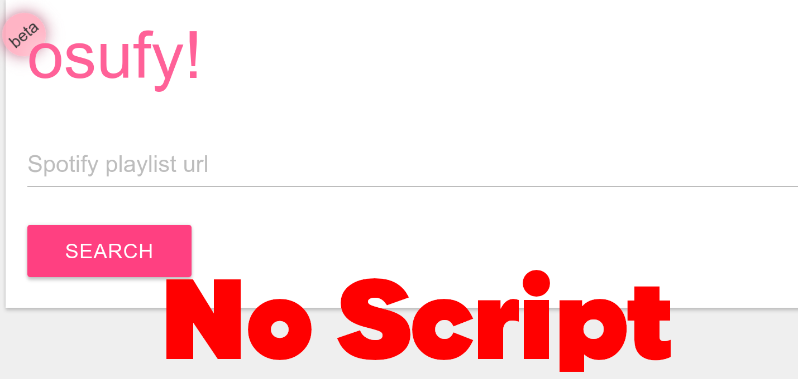
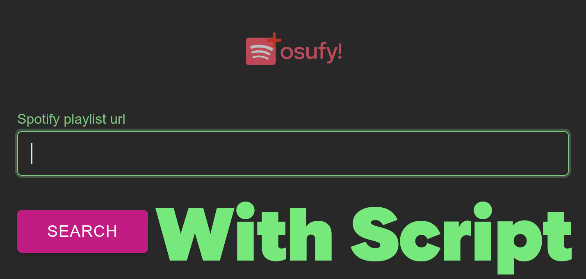
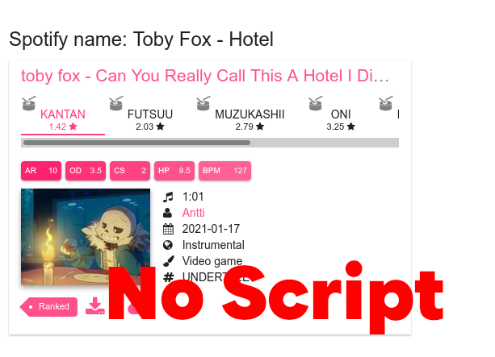

<h1 align="center">Better Osufy</h1>

A userscript that enhances the <a href="https://osufy.lonke.ro/">Osufy Website</a> experience with improved UI and additional features.

<h2>🔗・Links</h2>

- [Install (Raw)](https://github.com/Master3307/BetterOsufy/raw/refs/heads/main/Osufy.user.js)

<h2>👀・Features</h2>

- 🌙 Dark mode support
- 💅 Enhanced CSS styling
- 🎨 Improved overall user interface

<h2>🖼️・Screenshots</h2>

<h2>❕・Credits</h2>

Created as an enhancement for Osufy. If you're the developer of Osufy and would like to incorporate any of these improvements, feel free to use this code as reference, as I used some from you.
